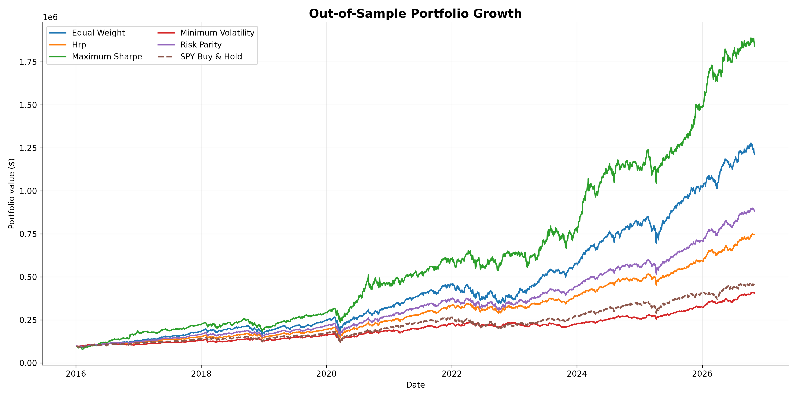
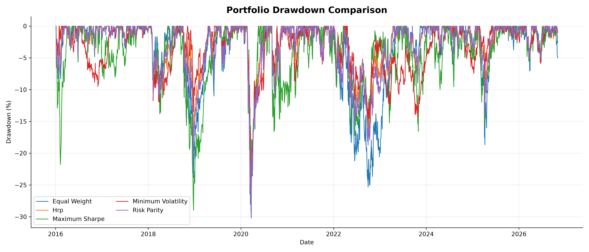
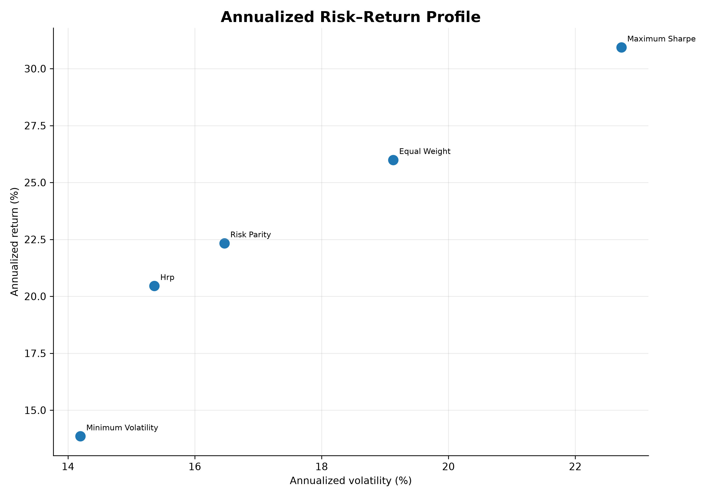
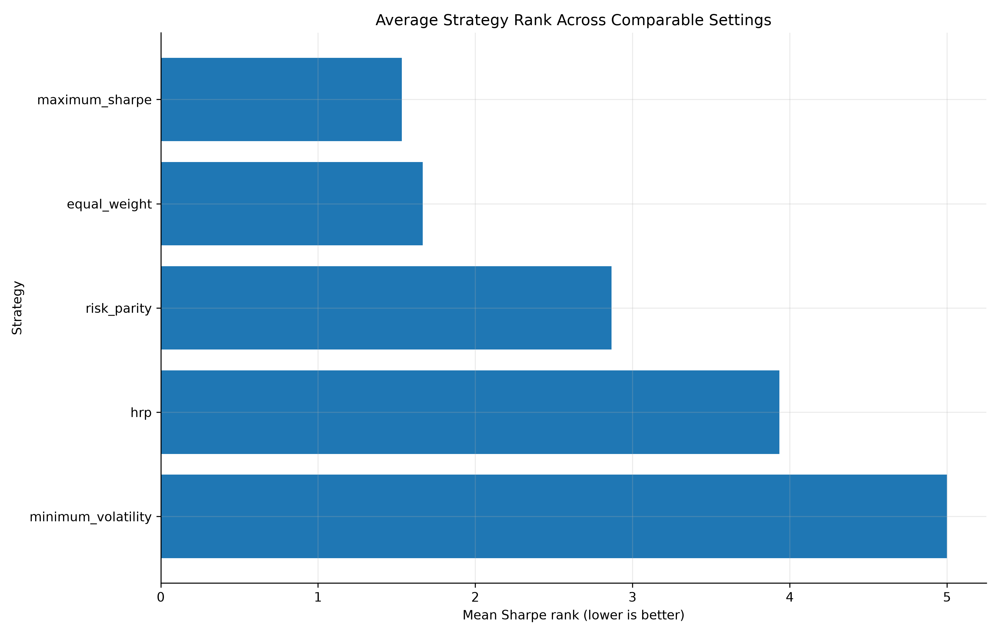
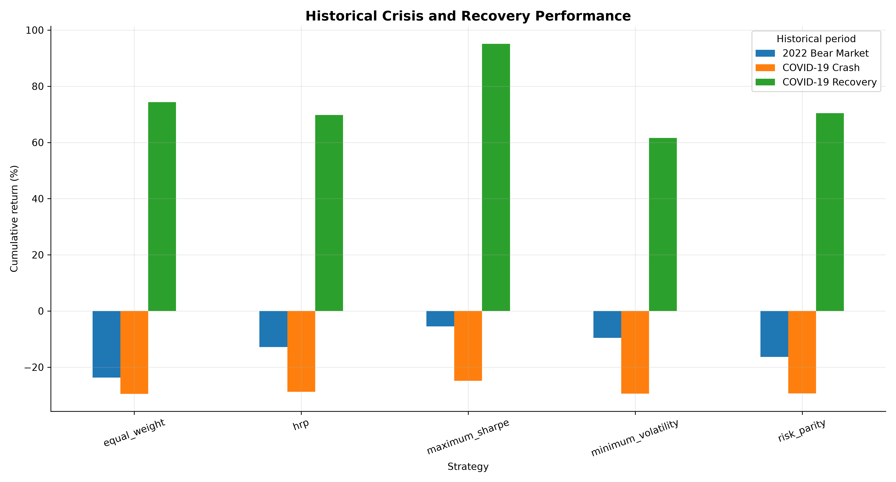
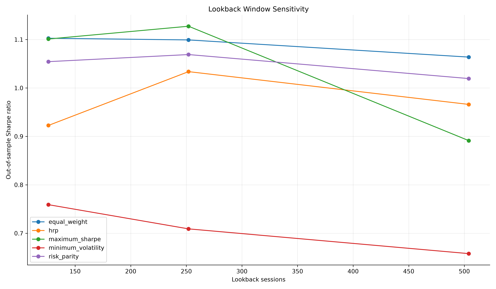
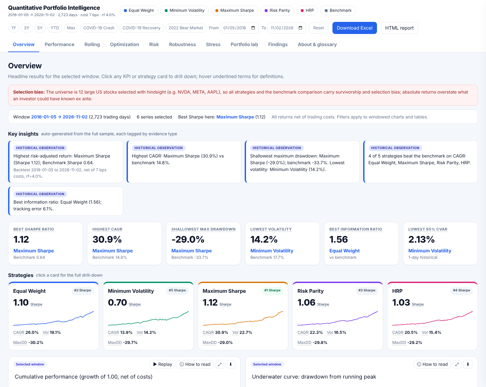
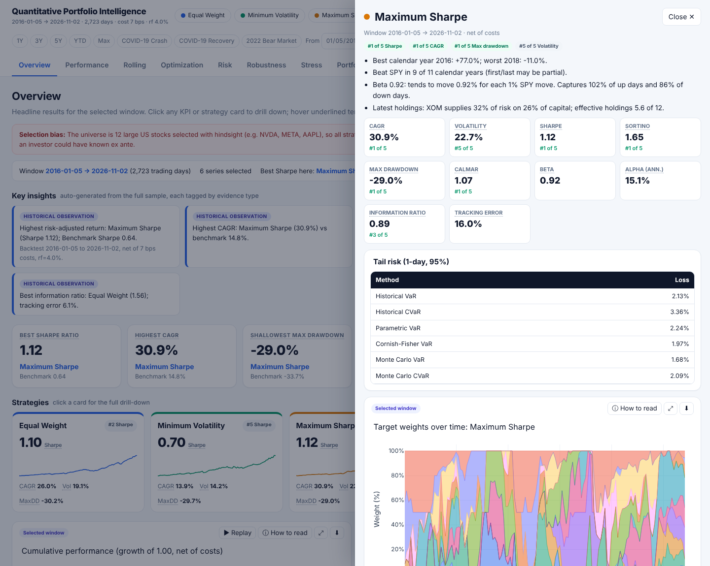
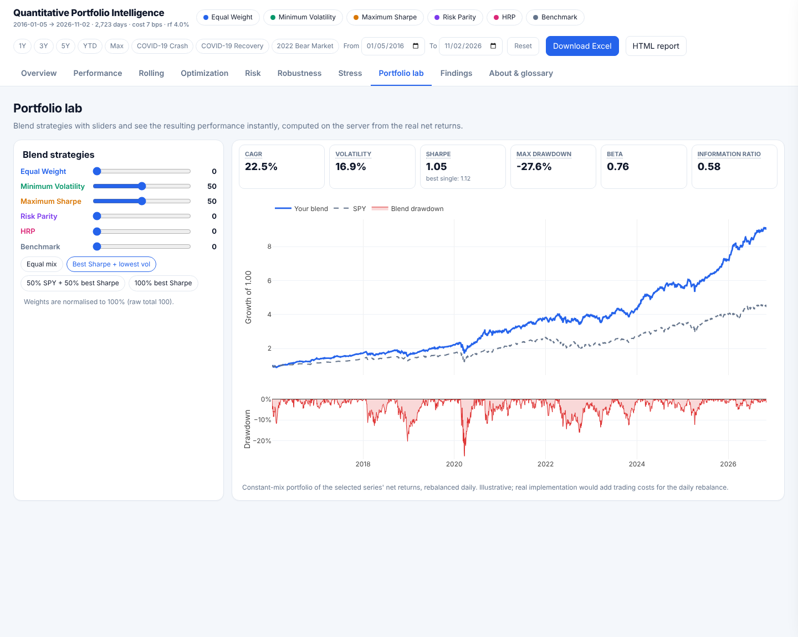
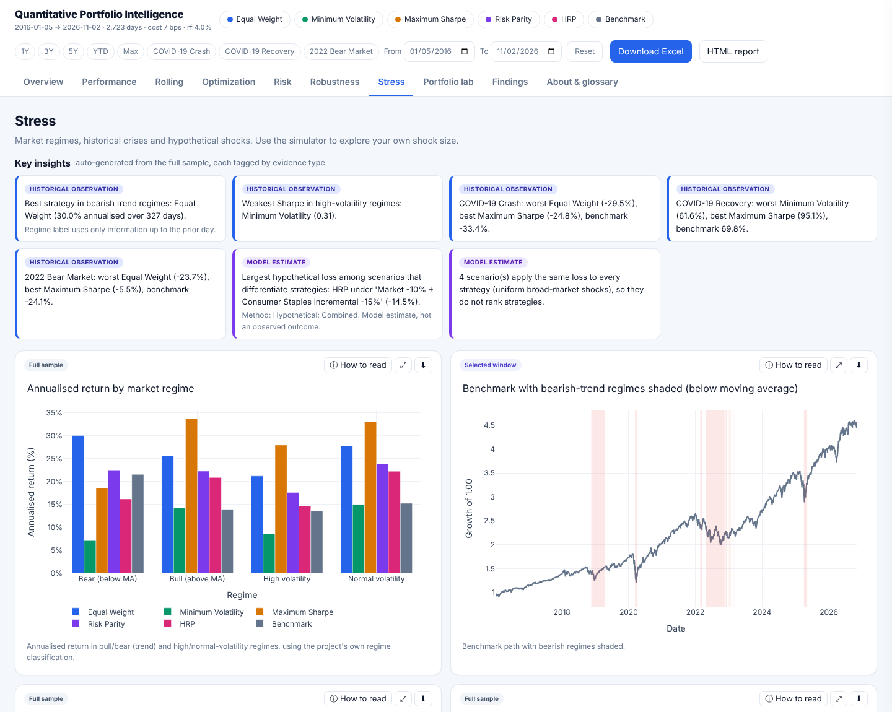

# Quantitative Portfolio Intelligence & Risk Optimization Platform

[](https://github.com/nasaamit005/quantitative-portfolio-intelligence-risk-optimization/actions/workflows/ci.yml)
[](https://github.com/nasaamit005/quantitative-portfolio-intelligence-risk-optimization/actions/workflows/deploy-dashboard.yml)
[](LICENSE)
[](pyproject.toml)
[](https://nasaamit005.github.io/quantitative-portfolio-intelligence-risk-optimization/)

**Walk-forward portfolio construction, risk analytics and automated reporting using real US equity market data.**

**Author:** Amit Singh · **GitHub:** [@nasaamit005](https://github.com/nasaamit005)

---

## Live Interactive Dashboard

### [Open the Quantitative Portfolio Intelligence Dashboard](https://nasaamit005.github.io/quantitative-portfolio-intelligence-risk-optimization/)

Explore performance, optimization strategies, risk analytics, robustness experiments, stress tests and findings across ten tabs: **Overview, Performance, Rolling, Optimization, Risk, Robustness, Stress, Portfolio lab, Findings** and **About & glossary**. No Python installation is needed.

> **Public dashboard vs. local application:** GitHub Pages hosts the static HTML dashboard. The full Python Flask application runs on your own computer, and its `127.0.0.1` address is not a public website. See [Section 8](#8-public-dashboard-vs-local-flask-application).

> **Research limitation:** The universe is 12 large US stocks, including AAPL, MSFT, NVDA and META, selected with hindsight. Every strategy and the SPY comparison therefore carries survivorship and selection bias. Absolute historical returns overstate what an investor could have known in 2016. Use the results to compare methods, not to forecast returns. This project is not investment advice.

---

## Contents

1. [Overview](#1-overview)
2. [Key Results](#2-key-results)
3. [Analytical Figures](#3-analytical-figures)
4. [Enhanced Interactive Analytics](#4-enhanced-interactive-analytics)
5. [Validation and Testing](#5-validation-and-testing)
6. [Installation](#6-installation)
7. [Usage](#7-usage)
8. [Public Dashboard vs. Local Flask Application](#8-public-dashboard-vs-local-flask-application)
9. [Repository Structure](#9-repository-structure)
10. [Research Limitations](#10-research-limitations)
11. [Data Sources and Licensing](#11-data-sources-and-licensing)
12. [Roadmap](#12-roadmap)
13. [How to Cite](#13-how-to-cite)
14. [License and Disclaimer](#14-license-and-disclaimer)

---

## 1. Overview

The project investigates one central question:

**Which portfolio construction method holds up out of sample, after costs, across parameter choices and market regimes, and how much risk does each strategy carry?**

It covers the complete quantitative portfolio research workflow using real daily US market data obtained from Yahoo Finance.

### Core Capabilities

- **Data engineering:** Data acquisition, cleaning, return construction, rolling statistics, and correlation and covariance estimation using sample covariance and Ledoit-Wolf shrinkage.
- **Portfolio optimization:** Minimum volatility, maximum Sharpe ratio, efficient frontier, Hierarchical Risk Parity (HRP), risk parity and Black-Litterman.
- **Walk-forward backtesting:** 252-day estimation lookback, monthly rebalancing, transaction costs and slippage, and five portfolio strategies compared against SPY.
- **Performance analytics:** CAGR, volatility, Sharpe ratio, drawdown episodes, rolling performance and benchmark-relative statistics.
- **Robustness and stress testing:** Sensitivity experiments covering lookback windows, transaction costs, rebalancing frequencies and weight constraints, plus market regimes, historical crises and hypothetical scenarios.
- **Automated reporting:** CSV and Parquet datasets, formula-driven Excel workbooks, interactive HTML reporting and a Flask analytics application.

## 2. Key Results

**Real historical data, net of portfolio transaction costs.**

| Evaluation Detail | Value |
|---|---|
| Evaluation period | 2016-01-05 to 2026-11-02 |
| Trading observations | 2,723 |
| Initial capital | $100,000 |
| Portfolio strategies | 5 |
| Benchmark | SPY |
| Rebalancing frequency | Monthly |
| Estimation lookback | 252 trading days |
| Transaction costs | 7 basis points |
| Risk-free rate | 4.0% |

### Strategy Performance Comparison

| Strategy | CAGR | Volatility | Sharpe | Max Drawdown | Information Ratio | Turnover | COVID Crash |
|---|---:|---:|---:|---:|---:|---:|---:|
| Maximum Sharpe | 30.9% | 22.7% | 1.13 | -29.0% | 0.89 | 30.1x | -24.8% |
| Equal Weight | 26.0% | 19.1% | 1.10 | -30.2% | 1.56 | 4.2x | -29.5% |
| Risk Parity | 22.3% | 16.5% | 1.07 | -29.8% | 0.95 | 4.6x | -29.3% |
| HRP | 20.5% | 15.4% | 1.03 | -29.2% | 0.55 | 11.7x | -28.8% |
| Minimum Volatility | 13.9% | 14.2% | 0.71 | -29.7% | -0.12 | 9.4x | -29.4% |
| SPY Benchmark | 14.8% | 17.7% | 0.65 | -33.7% | N/A | N/A | -33.4% |

> Sharpe ratios follow the project's documented performance analytics convention. The interactive dashboard can show values that differ by about 0.01 (for example 1.12 for Maximum Sharpe) because of rounding and calculation conventions. See the [Enhanced Reporting Documentation](docs/ENHANCED_REPORTING.md).

### Total Return Over the Full Window

| Strategy | Total Return | Calmar | Worst Day |
|---|---:|---:|---:|
| Maximum Sharpe | 1,739.95% | 1.068 | -8.83% |
| Equal Weight | 1,114.18% | 0.861 | -10.48% |
| Risk Parity | 783.03% | 0.749 | -9.36% |
| HRP | 647.29% | 0.701 | -8.42% |
| Minimum Volatility | 306.34% | 0.467 | -7.43% |
| SPY Benchmark | 344.89% | 0.439 | -10.94% |

### Key Findings

- **Maximum Sharpe achieved the highest historical return.** It was also the most concentrated and parameter-sensitive strategy. Its Sharpe ratio varied by 0.25 across the 15 robustness settings, compared with 0.09 for equal weight. At the latest rebalance, XOM represented 32% of portfolio risk with 26% of invested capital. Turnover reached 30.1x.
- **Equal weight remained highly competitive.** It achieved the best information ratio (1.56) and the second-highest Sharpe ratio, with relatively stable results.
- **Minimum volatility reduced portfolio volatility.** Annualized volatility was 14.2% against 17.7% for SPY, although its CAGR was below the benchmark.
- **Four of five strategies beat SPY on CAGR.** Only Minimum Volatility did not.
- **Drawdowns remained substantial across strategies.** Maximum drawdowns were approximately -29% to -30%, compared with -33.7% for SPY. Diversification methods did not eliminate the 2020 market crash.
- **Transaction costs had a measurable but relatively small effect.** At 7 basis points, the largest reported annual drag was approximately 0.20% for Maximum Sharpe. SPY is shown without trading costs, which slightly favours the benchmark.
- **Tails are fat for every strategy.** Excess kurtosis ranges from 7.8 (Maximum Sharpe) to 14.7 (SPY), so extreme days are far more common than a normal distribution implies.

## 3. Analytical Figures

The following figures are generated by the project's performance analytics, robustness analysis and stress-testing pipelines.

### Performance Analytics

| Cumulative Performance | Drawdown Comparison |
|---|---|
|  |  |

### Risk and Robustness

| Risk-Return Comparison | Robustness Scorecard |
|---|---|
|  |  |

### Stress Testing and Sensitivity

| Historical Crisis Returns | Lookback Sensitivity |
|---|---|
|  |  |

## 4. Enhanced Interactive Analytics

The enhanced reporting layer, `quantfin.enhanced`, consumes the existing project outputs. It does not independently rerun or duplicate the underlying portfolio strategies. It provides an interactive analytics experience, a formula-driven Excel workbook and a standalone HTML report.

### Dashboard Screenshots

| Dashboard Overview | Strategy Drill-Down |
|---|---|
|  |  |
| **Overview:** Key insights, KPIs, strategy scorecards and performance sparklines. | **Drill-down:** Strategy rankings, tail risk, holdings and risk contribution. |

| Portfolio Lab | Stress Analysis |
|---|---|
|  |  |
| **Portfolio Lab:** Blend strategies using interactive allocation sliders. | **Stress Analysis:** Explore market regimes, historical crises and hypothetical scenarios. |

### Dashboard Tabs

| Tab | What it shows |
|---|---|
| Overview | Key insights, headline KPIs and strategy scorecards with sparklines |
| Performance | Cumulative growth, drawdowns, and a sortable, filterable metrics table with heatmap |
| Rolling | Rolling Sharpe ratio and volatility through time |
| Optimization | Optimizer comparison, efficient frontier and portfolio weights |
| Risk | VaR and CVaR, tail shape, drawdown episodes and risk contribution |
| Robustness | Sensitivity to lookback, costs, rebalancing and constraints |
| Stress | Market regimes, historical crises and hypothetical shocks |
| Portfolio lab | Blend strategies with allocation sliders |
| Findings | Automated findings labelled by evidence type |
| About & glossary | Methodology and 34 glossary terms |

### Interactive Features

- **Flexible filtering:** Select strategies, custom date ranges and presets such as 1Y, 3Y, 5Y, YTD, COVID-19 Crash, COVID-19 Recovery and 2022 Bear Market. Windows as short as 15 days are supported, with warnings for periods shorter than 60 days.
- **Strategy drill-down:** Select a KPI or strategy card to inspect rankings, narrative insights, VaR and CVaR, holdings, risk contribution, drawdown episodes, monthly returns and return distributions.
- **Portfolio blending:** Combine strategies and SPY through allocation sliders. The server recalculates CAGR, volatility, Sharpe ratio, drawdown and beta from historical net returns. This is a constant-mix, daily-rebalanced illustration; transaction costs are not reapplied.
- **Market shock simulation:** Adjust the assumed SPY market shock from -50% to +30% and inspect beta-implied strategy movements. These are labelled model estimates.
- **Metric explorer:** Visualize any two performance metrics with a third measure shown as bubble size.
- **Historical replay:** Animate the cumulative growth of strategies over time.
- **Interactive explanations:** Charts include plain-English interpretation notes, and glossary terms show tooltips.
- **Data exploration:** Sortable and filterable tables, heatmap toggles, CSV exports, full-screen charts and PNG downloads.
- **Report downloads:** Download the generated Excel workbook and standalone HTML report.

### Enhanced Risk and Reporting Features

- A formula-driven Excel workbook with CAGR, volatility, Sharpe ratio, drawdown, Calmar ratio and beta formulas.
- Excel tables, conditional formatting and native charts.
- Excel-versus-Python metric agreement checks.
- Four VaR and CVaR approaches: historical, Gaussian, Cornish-Fisher and Monte Carlo.
- Component risk contributions for every strategy.
- Probabilistic Sharpe ratio and normality and autocorrelation diagnostics.
- Automated findings labelled as historical observations, model estimates or forward-looking assumptions.

For reporting design, data mapping and documented discrepancies, see [Enhanced Reporting Documentation](docs/ENHANCED_REPORTING.md).

## 5. Validation and Testing

The project includes **595 automated tests**, covering the core quantitative pipeline and enhanced reporting.

| Validation Area | Checks |
|---|---|
| Core pipeline | Optimizers, constraints, estimators, walk-forward backtesting, returns, risk and portfolio strategies |
| Metric definitions | Known-answer tests for CAGR, drawdown, Sharpe, alpha/beta, VaR methods and risk-contribution identities |
| Reporting consistency | Reporting-layer CAGR, volatility, drawdown, beta, tracking error and information ratio compared with `performance_summary.csv` |
| Input integrity | Strategy returns compared with `strategy_daily_results.csv`; benchmark date alignment; weights sum to one and respect constraints |
| Excel integrity | LibreOffice recalculation, formula-error checks and Excel-versus-Python agreement to 1e-9 |
| Dashboard | Chart and table routes, date filters, drill-down, portfolio blending, error handling and downloads |
| Regression protection | Existing application pages and original quantitative pipeline functionality |

```powershell
pytest          # run the test suite
ruff check .    # run lint checks
```

## 6. Installation

### Prerequisites

- Python 3.12 or 3.14
- Git
- Windows, Linux or macOS
- Internet access for downloading market data

### Clone the Repository

```powershell
git clone https://github.com/nasaamit005/quantitative-portfolio-intelligence-risk-optimization.git
cd quantitative-portfolio-intelligence-risk-optimization
```

### Create and Activate a Virtual Environment

**Windows PowerShell**

```powershell
python -m venv .venv
.\.venv\Scripts\Activate.ps1
```

**Linux / macOS**

```bash
python -m venv .venv
source .venv/bin/activate
```

### Install Dependencies

```powershell
python -m pip install --upgrade pip
python -m pip install -r requirements.txt
python -m pip install -e .
```

### Verify the Installation

```powershell
pytest
```

## 7. Usage

Each command runs one analytical workflow. Run them in this order for a full rebuild.

| Step | Command | Purpose |
|---|---|---|
| 1 | `python scripts/run_real_walk_forward_comparison.py` | Portfolio backtesting |
| 2 | `python scripts/run_performance_analytics.py` | Performance analytics |
| 3 | `python scripts/run_robustness_analysis.py` | Robustness analysis |
| 4 | `python scripts/run_portfolio_stress_testing.py` | Portfolio stress testing |
| 5 | `python scripts/run_automated_reporting.py` | Automated Excel reporting and supporting outputs |
| 6 | `python scripts/run_enhanced_reporting.py` | Enhanced workbook, HTML report and dashboard inputs |

### Launch the Flask Application

```powershell
python app.py
```

Wait until the terminal confirms the server is running, and keep the terminal open while you use the application:

```text
* Running on http://127.0.0.1:5000
```

Then open the dashboard at **http://127.0.0.1:5000/qpi/**.

On Windows without an activated environment, run `.\.venv\Scripts\python.exe app.py` from the project root.

## 8. Public Dashboard vs. Local Flask Application

The public GitHub Pages dashboard and the local Flask application are separate deployments. GitHub Pages publishes static files and does not run the Python backend.

| Feature | Public GitHub Pages dashboard | Local Flask application |
|---|---|---|
| Publicly accessible | Yes | No |
| Requires Python on the visitor's device | No | Yes, on the host computer |
| Runs the Flask backend | No | Yes |
| Interactive reporting | Yes, as published | Yes, with server-side recalculation |
| Access from another device | Yes | Not through localhost |
| URL | [Open the public dashboard](https://nasaamit005.github.io/quantitative-portfolio-intelligence-risk-optimization/) | `http://127.0.0.1:5000/qpi/` |

## 9. Repository Structure

```text
quantitative-portfolio-intelligence-risk-optimization/
│
├── app.py
│
├── src/
│   └── quantfin/
│       ├── data/
│       ├── features/
│       ├── estimators/
│       ├── optimization/
│       ├── strategies/
│       ├── backtesting/
│       ├── risk/
│       ├── analytics/
│       ├── visualization/
│       ├── services/
│       ├── utils/
│       └── enhanced/
│
├── scripts/
│   ├── run_real_walk_forward_comparison.py
│   ├── run_performance_analytics.py
│   ├── run_robustness_analysis.py
│   ├── run_portfolio_stress_testing.py
│   ├── run_automated_reporting.py
│   └── run_enhanced_reporting.py
│
├── config/
│   ├── settings.yaml
│   ├── assets.yaml
│   └── logging.yaml
│
├── data/
│   ├── raw/
│   └── processed/
│
├── reports/
│   ├── automated_reporting/
│   ├── backtests/
│   ├── excel/
│   ├── enhanced/
│   ├── figures/
│   ├── performance_analytics/
│   ├── robustness_analysis/
│   ├── stress_testing/
│   ├── tables/
│   └── walk_forward_comparison/
│
├── docs/
│   ├── ENHANCED_REPORTING.md
│   └── figures/
│
├── tests/
│   └── unit/
│
├── .github/
│   └── workflows/
│       ├── ci.yml
│       └── deploy-dashboard.yml
│
├── pyproject.toml
├── requirements.txt
├── README.md
├── LICENSE
└── CITATION.cff
```

The raw market data directory is excluded from Git. Processed datasets and generated reports are included to support reproducibility.

## 10. Research Limitations

- **Hindsight universe:** The 12-stock universe was selected with knowledge of the historical period. This introduces survivorship and selection bias and favours successful growth companies.
- **In-sample strategy design:** Strategy choices, lookback windows and weight constraints were developed after observing the dataset. Sensitivity analysis measures parameter dependence but does not eliminate selection bias.
- **Expected-return estimation:** Historical average returns have substantial estimation error. Maximum Sharpe optimization is particularly exposed to this uncertainty.
- **Hypothetical stress scenarios:** Uniform market shocks apply the same assumed loss across strategies and therefore do not independently rank their resilience. Asset and sector scenarios are linear model estimates.
- **Market regime classification:** Regimes use trailing-window classifications. Days labelled bear can include strong subsequent returns because the classification can lag rebounds. Interpret these as historical conditions following declines, not forecasts.
- **Transaction costs:** Costs use fixed basis points on turnover. Market impact, taxes, financing costs and short-selling costs are not modelled. SPY is shown without trading costs.
- **Parameter selection:** Robustness experiments evaluate selected parameter ranges; they do not establish that those ranges are optimal.
- **Not covered:** A dedicated out-of-sample lookback-selection analysis is not currently computed by the project.

## 11. Data Sources and Licensing

Market data are obtained from Yahoo Finance using `yfinance`. The raw market data are excluded from Git. Processed returns and analytical outputs are committed where appropriate to support reproducibility.

Check Yahoo Finance's terms and applicable data licensing conditions before redistributing raw market data.

## 12. Roadmap

- [ ] Introduce a point-in-time or broader historical index universe to reduce hindsight and survivorship bias.
- [ ] Add a dedicated out-of-sample holdout and walk-forward parameter-selection framework.
- [ ] Extend factor-based and regime-conditional stress scenarios.
- [ ] Expand the GitHub Pages dashboard with additional analytical visualizations and reporting features.
- [ ] Improve automated GitHub Pages deployment and public report validation.
- [ ] Expand portfolio constraints and institutional risk reporting.

## 13. How to Cite

See [CITATION.cff](CITATION.cff). GitHub provides a **Cite this repository** option when the citation file is available.

## 14. License and Disclaimer

This project is licensed under the [MIT License](LICENSE).

It is educational and quantitative-research software. It does not constitute investment advice, professional risk-management advice or regulatory guidance. Historical performance does not guarantee future results.

---

**Thank you for exploring the Quantitative Portfolio Intelligence & Risk Optimization Platform.**
